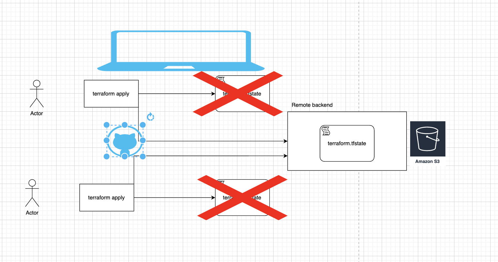

# Remote Backend und IAM

## Remote Zugriff ermöglichen anhand von S3



```
          Vorher                                    Nachher
 ┌──────────────────────┐              ┌─────────────────┐      ┌──────────────────────┐
 │ Dein Laptop          │              │ Dein Laptop     │      │ S3-Bucket            │
 │  main.tf             │              │  main.tf        │─────▶│  terraform.tfstate   │
 │  terraform.tfstate   │              │                 │      │  (+ ältere Versionen)│
 └──────────────────────┘              └─────────────────┘      └──────────────────────┘
```

0. Guckt, dass die .terraform Ordner, lock Datei und der tfstate von letzter Woche nicht mehr in dem Verzeichnis liegen
1. Kopiert euch die `.tf` Dateien aus dem [beispiel-1](../beispiel-1/), auch die `.tfvars`
2. Legt eine `terraform.tfvars` Datei an und befüllt die Variablen. Hier ein Auszug der `.tfvars` Datei:

```
vorname = "max"
key_name = "my-first-ssh-key"
```

3. In [providers.tf](./providers.tf) backend Block einkommentieren:

```
  backend "s3" {
    bucket       = "terraform-state-DEIN-NAME-12345"
    key          = "terraform-kurs/terraform.tfstate"
    region       = "us-east-1"
    encrypt      = true
    use_lockfile = true
  }

```

4. Meldet euch bei der AWS Konsole an und erstellt ein S3-Bucket (Hinweis: Name muss einzigartig sein)

5. Den Namen von dem S3 Bucket, als Wert für die folgende Zeile hinterlegen:

```
   bucket       = "terraform-state-DEIN-NAME-12345"
```

6. `terraform init`
7. Bevor ihr jetzt `terraform apply` anwendet bitte folgendes machen

## IAM

8. In der Konsole auf den Service IAM gehen
9. Dort den Benutzer teerraform anlegen (braucht keinen Konsolen Zugriff)
10. Nach dem erstellen --> auf den Benutzer --> Security Credentials --> Access Keys erstellen --> Secret Access Key und Access Key Id kopieren (Vorsicht: Secret Access Key seht ihr nur 1x)
11. Wieder auf terraform Benutzer in IAM gehen und die richtigen Permissions raussuchen (VPC, EC2, S3) (Für die profis: Versucht die Berechtigungen so weit wie möglich einzuschränken)
12. Ins Terminal auf eurem Laptop wechseln, mit den neuen Credentials die Session authentifizieren:

```bash
export AWS_ACCESS_KEY_ID=<terraform-user-access-key_id>
export AWS_SECRET_ACCESS_KEY=<terraform-user-secret-access-key>
```

13. `terraform apply`
14. Wenn ihr alles richtig hinterlegt, sollte das ohne Probleme durchlaufen
